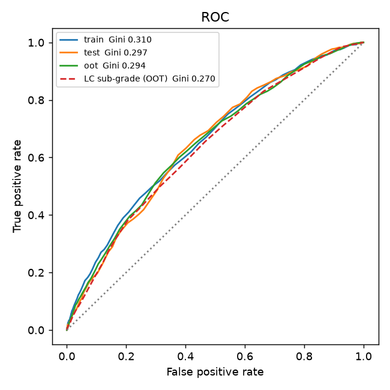
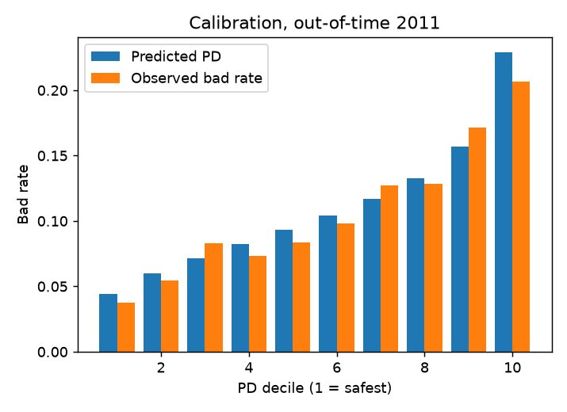
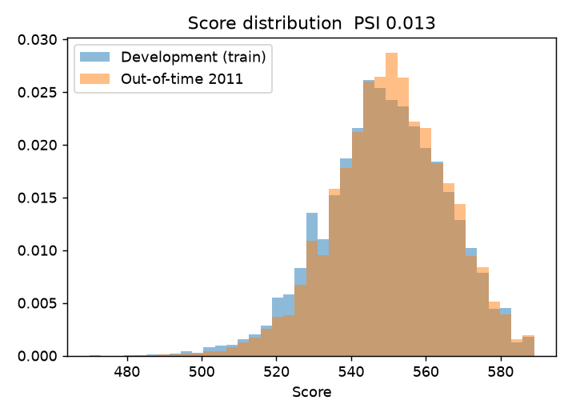
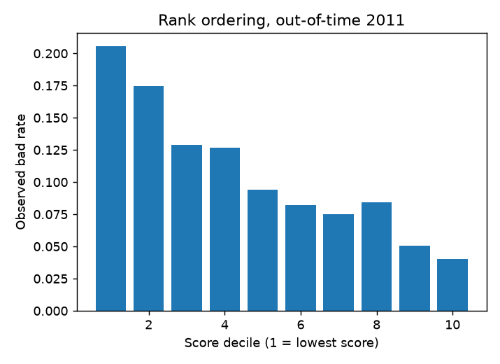

# Credit Risk PD Scorecard — Build and Independent Validation

A probability-of-default (PD) scorecard for 36-month consumer loans, built on 29,095 Lending Club loans (2007–2011) and validated the way a bank's model-risk team would review it: out-of-time testing, benchmarking, calibration, stability monitoring and a written validation report.

**Out-of-time results (2011 loans, never seen in development):**

| Check | Result |
|---|---|
| Discrimination | Gini **0.295** (95% CI 0.263–0.325), KS 0.221 |
| vs. Lending Club's own sub-grade | Gini 0.270 — scorecard ahead in 93% of bootstrap resamples (not significant at 5%) |
| vs. gradient-boosting challenger | Gini 0.295 — no difference; the challenger overfits (train Gini 0.568) |
| Rank ordering | Bad rate falls from 20.6% (lowest-score decile) to 4.0% (highest) |
| Calibration | Predicted 10.9% vs observed 10.6%; Hosmer–Lemeshow p = 0.03 → mild drift, recalibration recommended |
| Stability | Score PSI 0.013; every characteristic PSI ≤ 0.023 |

Full write-up: [reports/validation_report.md](reports/validation_report.md).

## The scorecard

Five characteristics, all known at application, all with the expected sign and VIF ≤ 1.14:

| Characteristic | IV | Riskiest bin → safest bin |
|---|---|---|
| Loan purpose | 0.097 | house / renewable energy / small business (23.5% bad) → credit card (7.6%) |
| Revolving utilisation | 0.069 | ≥ 86.9% (16.0%) → < 26.9% (8.1%) |
| Inquiries, last 6 months | 0.066 | 3+ (19.2%) → 0 (9.5%) |
| Payment-to-income | 0.063 | ≥ 12.6% (18.6%) → < 4.8% (9.4%) |
| Annual income | 0.030 | < $28K (15.8%) → ≥ $88.5K (9.7%) |

Bad rates are from the training sample. Points per bin are in `outputs/scorecard.csv`. Scaling: 600 points = 50:1 good:bad odds, and 20 points double the odds.

## How it works

```
sql/build_sample.sql   SQL: population rules, good/bad definition, leakage exclusions, exclusion waterfall
src/woe.py             WoE binning: monotonic numeric bins (≥5% each), risk-based pooling of rare categories
src/scorecard.py       IV filter → correlation filter → logistic regression with sign/p-value checks → points
src/validate.py        Gini, KS, PSI, calibration by decile, Hosmer–Lemeshow, binomial tests, bootstrap CIs
run_all.py             End-to-end run; writes outputs/ and reports/figures/
tests/                 Unit tests (binning, PSI, score scaling, metric sanity checks)
```

Key design decisions:
- **Final outcomes only.** Only 36-month loans are used, since every one has matured by the data snapshot. Many 60-month loans had not.
- **No leakage.** Payment and recovery fields are excluded. Lending Club's grade and interest rate are used only as a benchmark, never as inputs.
- **Out-of-time test.** Development uses 2007–2010 loans; 2011 is held out entirely.
- **Interpretable.** Monotonic bins and a points table that a credit officer can read.

## Run it

```bash
pip install -r requirements.txt
python scripts/download_data.py   # downloads LoanStats3a (~10 MB) and checks its SHA-256
python run_all.py                 # ~1 minute; writes outputs/ and reports/figures/
python -m pytest                  # 6 unit tests
```

Outputs:
- `outputs/metrics.json`: every number quoted here
- `outputs/scorecard.csv`: points table
- `outputs/scorecard_validation.xlsx`: summary, scorecard, IV, WoE bins, calibration, rank ordering, stability, benchmark, robustness, sample waterfall

## Charts

| | |
|---|---|
|  |  |
|  |  |

## Limitations

- Approved loans only; there's no reject inference.
- No bureau score (e.g. FICO) in the data, which limits discrimination.
- 2007–2011 includes the financial crisis.

Details are in section 7 of the validation report.

## Data

Lending Club loan data, 2007–2011 (`LoanStats3a`), via a public mirror of the original download. The raw file is not committed; `scripts/download_data.py` fetches it and verifies its checksum.
